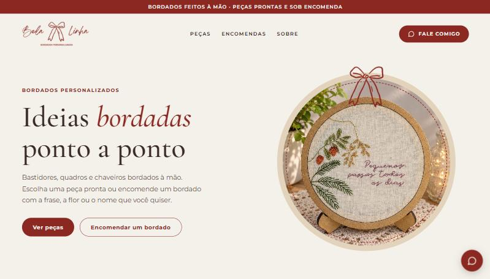
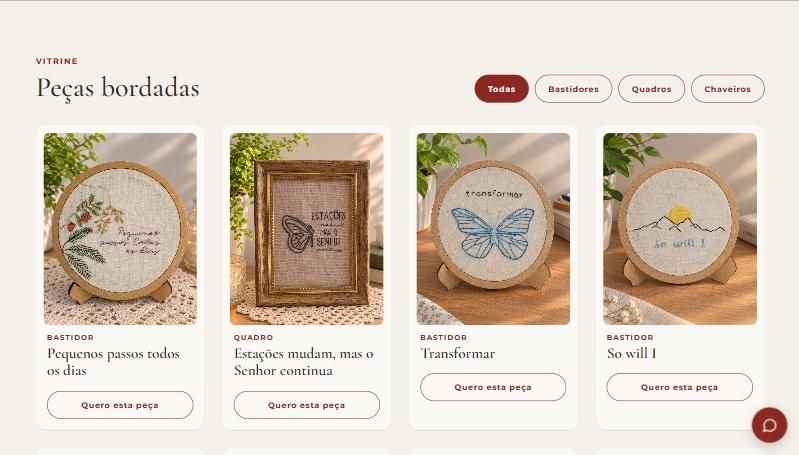
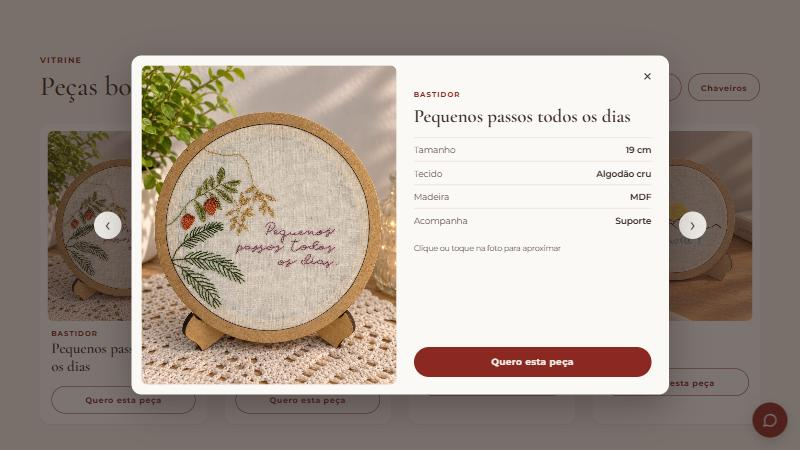
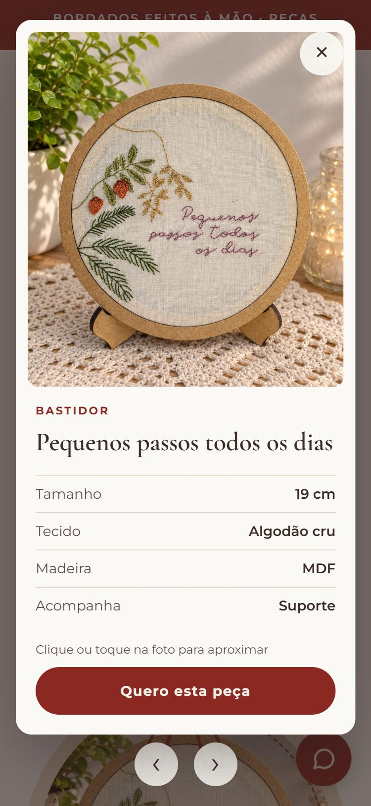
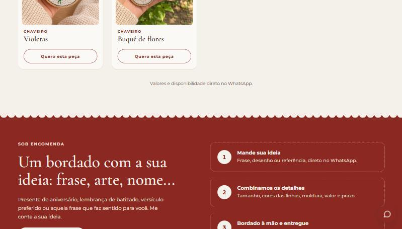
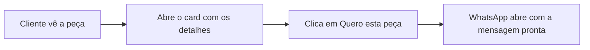

<div align="center">
  

  <h1>Bela Linha — Bordados personalizados</h1>

  <p><em>Ideias bordadas ponto a ponto.</em></p>

  <p>
    Site vitrine de bastidores, quadros e chaveiros bordados à mão.<br>
    Todos os pedidos vão direto para o WhatsApp.
  </p>
</div>



## Sumário

- [O que o site tem](#o-que-o-site-tem)
- [Como o pedido funciona](#como-o-pedido-funciona)
- [Estrutura dos arquivos](#estrutura-dos-arquivos)
- [Como ver o site no computador](#como-ver-o-site-no-computador)
- [Como adicionar uma peça](#como-adicionar-uma-peça)
- [Como alterar outras informações](#como-alterar-outras-informações)
- [Como publicar](#como-publicar)

## O que o site tem

### Vitrine com filtros

As peças podem ser filtradas por categoria: **Bastidores**, **Quadros** ou **Chaveiros**. Os círculos da seção "O que eu bordo" também aplicam o filtro e levam até a vitrine.



### Card com os detalhes da peça

Ao clicar na foto de uma peça, um card abre sobre a página com o tamanho, o tecido, a madeira e, nos bastidores, o aviso de que acompanha suporte.

- **Zoom:** clicar ou tocar na foto aproxima o ponto escolhido.
- **Setas:** ficam fora do card e passam para a peça anterior ou a próxima, respeitando o filtro ativo.
- **Teclado:** as setas `←` e `→` trocam de peça, e `Esc` fecha o card.

<table>
  <tr>
    <th>No computador</th>
    <th>No celular</th>
  </tr>
  <tr>
    <td></td>
    <td></td>
  </tr>
</table>

### Encomendas personalizadas

Uma seção explica como pedir um bordado com frase, arte ou nome, em três passos.



### Outros detalhes

- **Animação ao rolar:** os itens surgem aos poucos conforme a página desce. Quem desativa animações no aparelho vê tudo normalmente.
- **Feito para celular:** o layout se adapta a telas pequenas.
- **Botão flutuante:** o WhatsApp fica sempre ao alcance, no canto da tela.

## Como o pedido funciona



A mensagem já leva o nome e o tipo da peça, então a Bela Linha sabe na hora de qual item a pessoa está falando. O site não tem carrinho nem pagamento: valores e disponibilidade são combinados na conversa.

## Estrutura dos arquivos

O site é estático: só HTML, CSS e JavaScript, sem etapa de build e sem dependências para instalar.

```
bela-linha/
├── index.html   → conteúdo da página
├── style.css    → visual (cores no topo, em :root)
├── script.js    → WhatsApp, filtros, card da peça e animação ao rolar
├── img/         → logo, fotos das peças e favicon
└── docs/        → imagens usadas neste README
```

## Como ver o site no computador

Abra o `index.html` no navegador com dois cliques ou, se tiver Python instalado, rode dentro da pasta `bela-linha`:

```bash
python -m http.server 8123
```

Depois acesse `http://localhost:8123`.

## Como adicionar uma peça

1. Coloque a foto em `img/`, de preferência em JPG, em pé, na proporção 4:5 e com até cerca de 900 px de largura.
2. No `index.html`, copie um bloco `<article class="peca">` já existente.
3. Troque as informações do bloco:

```html
<article class="peca" data-cat="bastidores" data-tamanho="19 cm">
  <div class="peca__foto"></div>
  <div class="peca__info"><span class="peca__tipo">Bastidor</span><h3>Nome da peça</h3></div>
  <a class="btn btn--borda" href="https://wa.me/5512992582542" target="_blank" rel="noopener">Quero esta peça</a>
</article>
```

| O que trocar | Para que serve | Valores |
|---|---|---|
| `data-cat` | Define o filtro da peça | `bastidores`, `quadros` ou `chaveiros` |
| `data-tamanho` | Tamanho mostrado no card | Por exemplo, `19 cm` ou `18 x 13 cm` |
| `src` e `alt` | Foto e sua descrição | Caminho da foto e um texto descrevendo a imagem |
| `peca__tipo` | Tipo mostrado na peça | `Bastidor`, `Quadro` ou `Chaveiro` |
| `h3` | Nome da peça | Texto livre |

Pronto: o link do WhatsApp, o card e a animação funcionam sozinhos. O aviso de suporte aparece automaticamente nas peças da categoria `bastidores`.

## Como alterar outras informações

| O que mudar | Onde |
|---|---|
| Número do WhatsApp | Constante `WHATSAPP`, no início do `script.js` (DDI + DDD + número, só números) |
| Tecido e madeira do card | Bloco `<dialog>`, no final do `index.html` |
| Cores e fontes | Variáveis em `:root`, no início do `style.css` |

## Como publicar

1. Crie um repositório no GitHub e envie os arquivos.
2. Na Vercel, clique em **Add New → Project** e importe o repositório.
3. Deixe o **Framework Preset** como **Other**.
4. Se o `index.html` estiver dentro da pasta `bela-linha` no repositório, escolha essa pasta em **Root Directory**.
5. Clique em **Deploy**.

Depois disso, cada `git push` publica o site de novo automaticamente.
